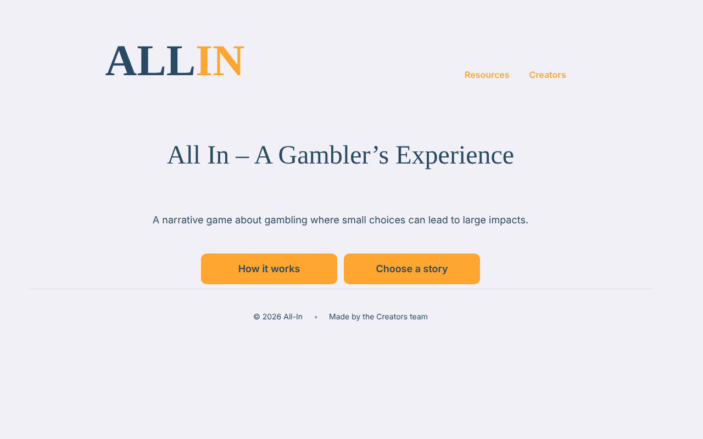
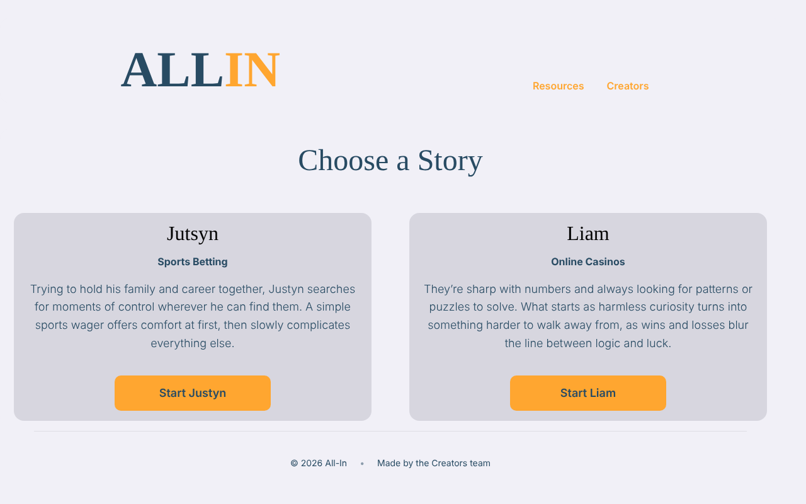
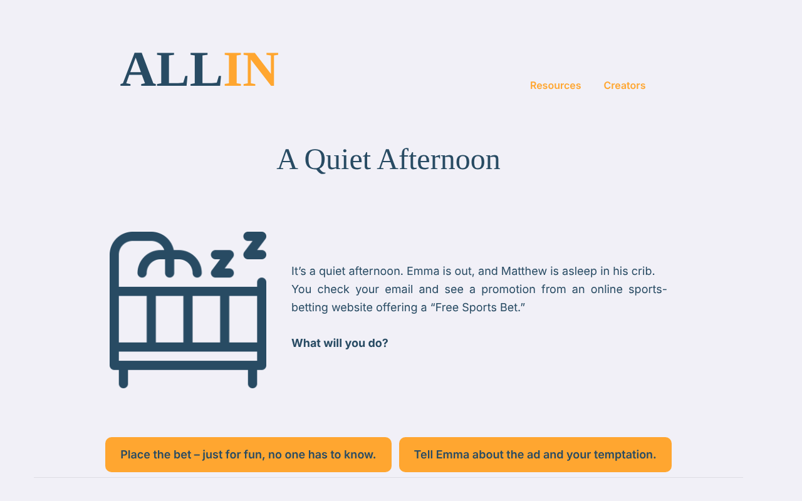
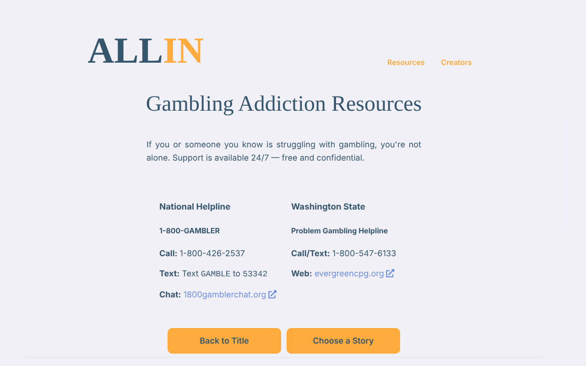

# All In – A Gambler's Experience

[](https://github.com/LPMaster00/all-in/actions/workflows/tests.yml)

An empathy-building interactive story about how gambling addiction takes hold. You play as Justyn or Liam, and every choice moves your **mood**, **trust** and **money**. The story ends by pointing you to real support resources.

**[▶ Play it in your browser](https://lpmaster00.github.io/all-in/)** · **[Watch the demo video](https://www.youtube.com/watch?v=sRprDOQ6oNU)**



| Choose a story | A branching choice | Support resources |
| --- | --- | --- |
|  |  |  |

## About the project

Built for CSCI 436/536 *Technology for Social Good* at Western Washington University (Fall 2025). We started from research rather than code: a literature review, an interview with a stakeholder, and storylines based on real accounts of recovery. Then we prototyped and built the game in Twine.

- **2 playable characters, 46 passages**, with branching paths and multiple endings
- **Stat tracking** with SugarCube variables (`$mood`, `$trust`, `$money`) and conditional logic
- **Custom HTML/CSS UI** layered over Twine's SugarCube story format
- **Resources page** linking to 1-800-GAMBLER and Washington State's problem gambling helpline

## Testing

The story is checked end to end with [Playwright](https://playwright.dev/) (`tests/story.spec.js`), running in Chromium, Firefox and mobile Safari on every push via GitHub Actions:

| Test | What it catches |
| --- | --- |
| Start screen loads | The game boots and both entry points are visible |
| Every link resolves | A choice pointing to a passage that doesn't exist |
| No dead ends | A story screen with no way forward |
| Every passage renders cleanly | SugarCube errors and images that fail to load, on all 46 passages |
| Full playthrough | A complete path through Justyn's story reaches an ending |

When the suite was first run against the shipped build, it found **two images that never loaded**: their paths were missing the file extension's dot (`images/scammedpng`, `images/notificationpng`). Both are fixed in this version.

### Run the tests

```bash
npm install
npx playwright install
npm test
```

## Run the game locally

Open `index.html` in any browser. There's nothing to install.

## Built with

Twine 2 · SugarCube 2 · HTML · CSS · JavaScript · Playwright · GitHub Actions

## Team

- **Hamza Magsi**: original game concept, character development, Twine implementation, testing
- **Leyton Houck**: visual design, character development

If you or someone you know is struggling with gambling, call or text **1-800-GAMBLER** (1-800-426-2537). It's free, confidential and available 24/7.
